<!--
  Profile README for @OtazuaMiguel · monochrome, light/dark aware.
  The SVGs in assets/ are generated by scripts/generate-assets.py
  (edit the texts there and run: python3 scripts/generate-assets.py assets).
-->

<a href="https://github.com/OtazuaMiguel">
<picture>
  <source media="(prefers-color-scheme: dark)" srcset="assets/header-dark.svg" />
  <source media="(prefers-color-scheme: light)" srcset="assets/header-light.svg" />
  
</picture>
</a>

 

<picture>
  <source media="(prefers-color-scheme: dark)" srcset="assets/section-about-dark.svg" />
  <source media="(prefers-color-scheme: light)" srcset="assets/section-about-light.svg" />
  
</picture>

I study **Data Science and Business Administration** at the Public University of Navarre (UPNA).
I'm drawn to the place where data, product and business meet, and I learn best by building
things people can actually use.

- **Now** — building TrainViewer, a real-time map of Spain's railways
- **Next** — EuskaGo, a gamified app to learn Basque
- **Learning** — Python, SQL and machine learning
- **Off-screen** — tinkering with my homelab

 

<picture>
  <source media="(prefers-color-scheme: dark)" srcset="assets/section-stack-dark.svg" />
  <source media="(prefers-color-scheme: light)" srcset="assets/section-stack-light.svg" />
  
</picture>

<picture>
  <source media="(prefers-color-scheme: dark)" srcset="https://skillicons.dev/icons?i=ts,js,html,css,react,vite,tailwind,nodejs,deno,supabase,postgres,git,githubactions,linux,raspberrypi,vscode&perline=8&theme=dark" />
  <source media="(prefers-color-scheme: light)" srcset="https://skillicons.dev/icons?i=ts,js,html,css,react,vite,tailwind,nodejs,deno,supabase,postgres,git,githubactions,linux,raspberrypi,vscode&perline=8&theme=light" />
  
</picture>

Also: React Native · Expo · shadcn/ui · Leaflet · D3 · TanStack Query · Zustand · Zod · Jest · Playwright · Pi-hole

 

<picture>
  <source media="(prefers-color-scheme: dark)" srcset="assets/section-projects-dark.svg" />
  <source media="(prefers-color-scheme: light)" srcset="assets/section-projects-light.svg" />
  
</picture>

<a href="https://otazuamiguel.github.io/TrainViewer/"><picture>
  <source media="(prefers-color-scheme: dark)" srcset="assets/card-trainviewer-dark.svg" />
  <source media="(prefers-color-scheme: light)" srcset="assets/card-trainviewer-light.svg" />
  
</picture></a>
<picture>
  <source media="(prefers-color-scheme: dark)" srcset="assets/card-euskago-dark.svg" />
  <source media="(prefers-color-scheme: light)" srcset="assets/card-euskago-light.svg" />
  
</picture>

<a href="https://github.com/OtazuaMiguel/momentum-launch"><picture>
  <source media="(prefers-color-scheme: dark)" srcset="assets/card-momentum-dark.svg" />
  <source media="(prefers-color-scheme: light)" srcset="assets/card-momentum-light.svg" />
  
</picture></a>
<a href="https://github.com/OtazuaMiguel/pihole"><picture>
  <source media="(prefers-color-scheme: dark)" srcset="assets/card-homelab-dark.svg" />
  <source media="(prefers-color-scheme: light)" srcset="assets/card-homelab-light.svg" />
  
</picture></a>

 

<picture>
  <source media="(prefers-color-scheme: dark)" srcset="assets/section-activity-dark.svg" />
  <source media="(prefers-color-scheme: light)" srcset="assets/section-activity-light.svg" />
  
</picture>

<picture>
  <source media="(prefers-color-scheme: dark)" srcset="https://github-readme-stats.vercel.app/api?username=OtazuaMiguel&show_icons=true&include_all_commits=true&count_private=true&rank_icon=github&bg_color=0a0a0a&border_color=262626&title_color=ededed&text_color=8f8f8f&icon_color=ededed&ring_color=ededed&border_radius=18" />
  <source media="(prefers-color-scheme: light)" srcset="https://github-readme-stats.vercel.app/api?username=OtazuaMiguel&show_icons=true&include_all_commits=true&count_private=true&rank_icon=github&bg_color=fafafa&border_color=e4e4e4&title_color=111111&text_color=6b6b6b&icon_color=111111&ring_color=111111&border_radius=18" />
  
</picture>
<picture>
  <source media="(prefers-color-scheme: dark)" srcset="https://streak-stats.demolab.com?user=OtazuaMiguel&background=0a0a0a&border=262626&stroke=262626&ring=ededed&fire=ededed&currStreakNum=ededed&sideNums=ededed&currStreakLabel=ededed&sideLabels=8f8f8f&dates=8f8f8f&border_radius=18" />
  <source media="(prefers-color-scheme: light)" srcset="https://streak-stats.demolab.com?user=OtazuaMiguel&background=fafafa&border=e4e4e4&stroke=e4e4e4&ring=111111&fire=111111&currStreakNum=111111&sideNums=111111&currStreakLabel=111111&sideLabels=6b6b6b&dates=6b6b6b&border_radius=18" />
  
</picture>

<picture>
  <source media="(prefers-color-scheme: dark)" srcset="https://github-readme-stats.vercel.app/api/top-langs/?username=OtazuaMiguel&layout=compact&langs_count=6&bg_color=0a0a0a&border_color=262626&title_color=ededed&text_color=8f8f8f&border_radius=18" />
  <source media="(prefers-color-scheme: light)" srcset="https://github-readme-stats.vercel.app/api/top-langs/?username=OtazuaMiguel&layout=compact&langs_count=6&bg_color=fafafa&border_color=e4e4e4&title_color=111111&text_color=6b6b6b&border_radius=18" />
  
</picture>
<picture>
  <source media="(prefers-color-scheme: dark)" srcset="https://github-readme-stats.vercel.app/api/wakatime?username=OtazuaMiguel&layout=compact&langs_count=6&custom_title=This%20week%20in%20code&bg_color=0a0a0a&border_color=262626&title_color=ededed&text_color=8f8f8f&icon_color=ededed&border_radius=18" />
  <source media="(prefers-color-scheme: light)" srcset="https://github-readme-stats.vercel.app/api/wakatime?username=OtazuaMiguel&layout=compact&langs_count=6&custom_title=This%20week%20in%20code&bg_color=fafafa&border_color=e4e4e4&title_color=111111&text_color=6b6b6b&icon_color=111111&border_radius=18" />
  
</picture>

<picture>
  <source media="(prefers-color-scheme: dark)" srcset="https://github-readme-activity-graph.vercel.app/graph?username=OtazuaMiguel&bg_color=0a0a0a&color=8f8f8f&line=ededed&point=ededed&area=true&area_color=ededed&title_color=ededed&hide_border=true&radius=18&custom_title=Contributions" />
  <source media="(prefers-color-scheme: light)" srcset="https://github-readme-activity-graph.vercel.app/graph?username=OtazuaMiguel&bg_color=fafafa&color=6b6b6b&line=111111&point=111111&area=true&area_color=111111&title_color=111111&hide_border=true&radius=18&custom_title=Contributions" />
  
</picture>

<picture>
  <source media="(prefers-color-scheme: dark)" srcset="https://raw.githubusercontent.com/OtazuaMiguel/OtazuaMiguel/output/snake-dark.svg" />
  <source media="(prefers-color-scheme: light)" srcset="https://raw.githubusercontent.com/OtazuaMiguel/OtazuaMiguel/output/snake-light.svg" />
  
</picture>

 

<picture>
  <source media="(prefers-color-scheme: dark)" srcset="assets/section-contact-dark.svg" />
  <source media="(prefers-color-scheme: light)" srcset="assets/section-contact-light.svg" />
  
</picture>

Open to internships, data projects and collaborations — my DMs are open.

<a href="https://www.linkedin.com/in/miguel-otazua"><picture>
  <source media="(prefers-color-scheme: dark)" srcset="assets/pill-linkedin-dark.svg" />
  <source media="(prefers-color-scheme: light)" srcset="assets/pill-linkedin-light.svg" />
  
</picture></a>
<a href="https://www.instagram.com/m_otazua"><picture>
  <source media="(prefers-color-scheme: dark)" srcset="assets/pill-instagram-dark.svg" />
  <source media="(prefers-color-scheme: light)" srcset="assets/pill-instagram-light.svg" />
  
</picture></a>

 

<picture>
  <source media="(prefers-color-scheme: dark)" srcset="assets/footer-dark.svg" />
  <source media="(prefers-color-scheme: light)" srcset="assets/footer-light.svg" />
  
</picture>

  

